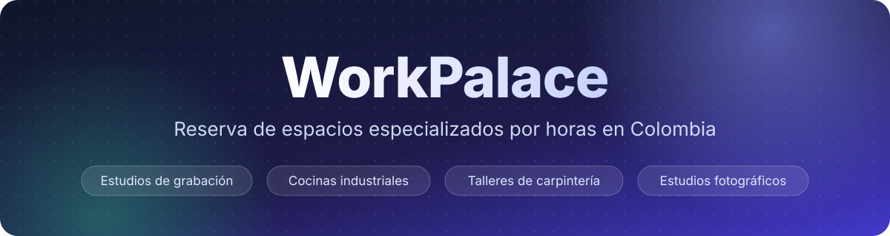
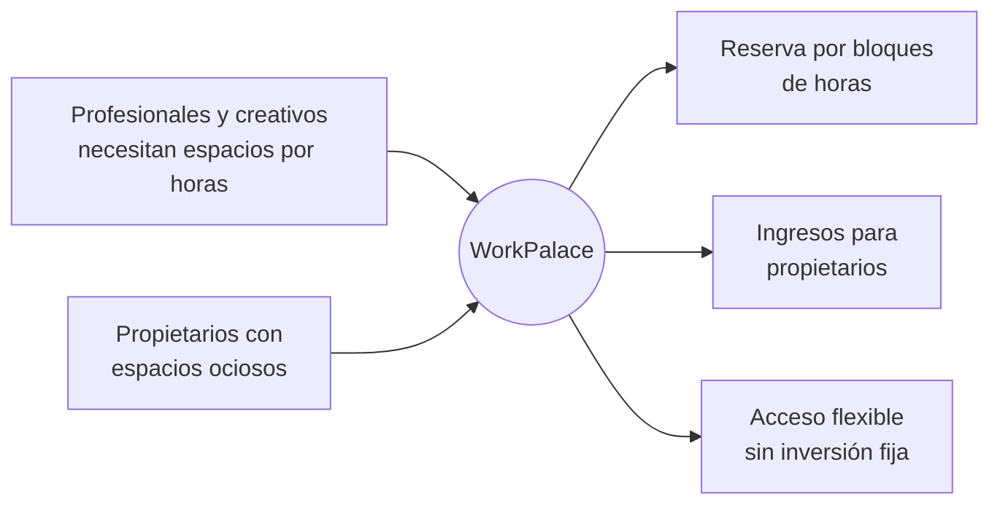

<div align="center">



<br />
<br />

Conectamos a quienes necesitan infraestructura profesional con propietarios de espacios que hoy permanecen ociosos.

<br />


<br />

[Problema](#el-problema) &nbsp;•&nbsp;
[Solución](#la-solución) &nbsp;•&nbsp;
[Mercado](#mercado-y-modelo-de-negocio) &nbsp;•&nbsp;
[Funcionalidades](#funcionalidades-clave) &nbsp;•&nbsp;
[Calidad](#atributos-de-calidad) &nbsp;•&nbsp;
[Tecnologías](#tecnologías) &nbsp;•&nbsp;
[Inicio rápido](#inicio-rápido) &nbsp;•&nbsp;
[Equipo](#equipo)

</div>

<br />

> [!NOTE]
> Proyecto en fase inicial. Este repositorio contiene la versión actual del frontend y del backend para la gestión de reservas, autenticación y administración del servicio.

<br />

<table align="center">
  <tr>
    <td align="center" width="25%"><h2>4</h2>categorías de espacio</td>
    <td align="center" width="25%"><h2>5</h2>funcionalidades clave</td>
    <td align="center" width="25%"><h2>10 – 15 %</h2>comisión por reserva</td>
    <td align="center" width="25%"><h2>4</h2>atributos ISO/IEC 25010</td>
  </tr>
</table>

<br />

## El problema

Muchos profesionales independientes, emprendedores y creativos en distintas ciudades de Colombia necesitan espacios especializados para desarrollar su actividad económica. Mantener esa infraestructura de forma permanente resulta inasumible para la mayoría, sobre todo cuando el uso es esporádico.

Al mismo tiempo, muchas localidades tienen espacios infrautilizados: instalaciones que pasan ociosas buena parte del día o de la semana, lo que representa una pérdida de oportunidades económicas tanto para sus propietarios como para el ecosistema productivo local.

<table>
  <tr>
    <td width="50%" valign="top">
      
      <b>¿Qué problema existe?</b><br /><br />
      Acceso limitado a infraestructura costosa, combinado con espacios vacíos que generan pérdida de oportunidades económicas para propietarios y usuarios.
    </td>
    <td width="50%" valign="top">
      
      <b>¿A quién afecta?</b><br /><br />
      Profesionales independientes, emprendedores, creativos y propietarios de espacios infrautilizados en distintas ciudades de Colombia.
    </td>
  </tr>
</table>

> [!IMPORTANT]
> **Ineficiencia de mercado:** existe oferta de infraestructura ociosa y demanda insatisfecha de acceso flexible, pero no hay un mecanismo confiable, seguro y accesible que conecte a ambas partes.

## La solución

**WorkPalace** conecta ambas puntas del mercado con un canal confiable, seguro y accesible.



### Espacios disponibles

<table>
  <tr>
    <td align="center" width="25%"><br /><br /><b>Estudios de grabación</b></td>
    <td align="center" width="25%"><br /><br /><b>Cocinas industriales</b></td>
    <td align="center" width="25%"><br /><br /><b>Talleres de carpintería</b></td>
    <td align="center" width="25%"><br /><br /><b>Estudios fotográficos</b></td>
  </tr>
</table>

## Mercado y modelo de negocio

> [!TIP]
> **Demanda.** Estudios locales evidencian una demanda sostenida de espacios especializados por bloques de horas, en lugar de arrendamientos permanentes o de largo plazo.

**Perfil del mercado.** La investigación de Mora Martínez (2015) reporta que cerca del **22,3 %** de los trabajadores independientes analizados son hombres de alrededor de 45 años: un segmento significativo de profesionales maduros que ejercen de forma autónoma y sin infraestructura propia permanente.

<table>
  <tr>
    <td align="center" width="50%">
      <h3>Plan Normal</h3>
      <h1>15 %</h1>
      comisión por reserva<br /><br />
      <sub>Ganancia estimada por reserva (usuario)</sub><br />
      <b>$34.000 – $36.000 COP</b>
    </td>
    <td align="center" width="50%">
      <h3>Plan Pro</h3>
      <h1>10 %</h1>
      comisión por reserva<br /><br />
      <sub>Ganancia estimada por reserva (usuario)</sub><br />
      <b>$34.000 – $36.000 COP</b>
    </td>
  </tr>
</table>

## Funcionalidades clave

<table>
  <tr>
    <td align="center" width="20%"><br /><br /><b>Reservas por bloques horarios</b></td>
    <td align="center" width="20%"><br /><br /><b>Pagos en línea</b></td>
    <td align="center" width="20%"><br /><br /><b>Verificación de identidad</b></td>
    <td align="center" width="20%"><br /><br /><b>Disponibilidad en tiempo real</b></td>
    <td align="center" width="20%"><br /><br /><b>Filtros y búsqueda avanzada</b></td>
  </tr>
</table>

## Atributos de calidad

Seleccionados bajo el estándar **ISO/IEC 25010**.

<table>
  <tr>
    <td align="center" width="25%"><br /><br /><b>Seguridad</b></td>
    <td align="center" width="25%"><br /><br /><b>Fiabilidad</b></td>
    <td align="center" width="25%"><br /><br /><b>Usabilidad</b></td>
    <td align="center" width="25%"><br /><br /><b>Eficiencia de desempeño</b></td>
  </tr>
</table>

## Tecnologías

<table>
  <tr>
    <th align="left" width="20%">Capa</th>
    <th align="left" width="40%">Tecnología</th>
    <th align="left" width="40%">Despliegue</th>
  </tr>
  <tr>
    <td><b>Frontend</b></td>
    <td></td>
    <td></td>
  </tr>
  <tr>
    <td><b>Backend</b></td>
    <td> </td>
    <td></td>
  </tr>
  <tr>
    <td><b>Base de datos</b></td>
    <td></td>
    <td><a href="https://neon.tech/"></a></td>
  </tr>
</table>

## Inicio rápido

> [!NOTE]
> Se recomienda Node.js 18 o superior. La configuración local puede variar según tu entorno PostgreSQL o Docker.

**1. Instala las dependencias**

```bash
npm install
```

**2. Configura las variables de entorno** en un archivo `.env`:

```env
DB_HOST=localhost
DB_PORT=5432
DB_NAME=WorkPalace
DB_USER=postgres
DB_PASSWORD=postgres
PORT=3001
```

> [!WARNING]
> Ajusta estos valores a tu entorno. El archivo `.env` no debe incluir credenciales reales compartidas.

**3. Levanta la base de datos** (local o con Docker)

```bash
docker-compose up -d
```

**4. Inicia el backend**

```bash
npm run server
```

**5. Inicia el frontend** en otra terminal

```bash
npm run dev
```

Con el backend activo, la documentación interactiva de la API queda en [`http://localhost:3001/api-docs`](http://localhost:3001/api-docs) y la especificación OpenAPI en [`/api-docs.json`](http://localhost:3001/api-docs.json). Si cambias `PORT`, sustituye `3001` por tu puerto; la dirección también aparece en la consola del backend.

### Scripts disponibles

| Comando | Descripción |
|:--|:--|
| `npm run dev` | Inicia el frontend en modo desarrollo |
| `npm run server` | Inicia el backend |
| `npm run build` | Genera el build de producción |
| `npm run lint` | Ejecuta el linter |
| `npm run preview` | Previsualiza el build |

### Comandos básicos de Git

Clona el repositorio y entra a su carpeta:

```bash
git clone https://github.com/Damg53/WorkPalace-.git
cd WorkPalace-
```

Consulta el estado de tus archivos y las ramas disponibles:

```bash
git status
git branch
```

Para trabajar en una rama nueva, actualiza `main` y crea tu rama:

```bash
git switch main
git pull origin main
git switch -c feature/nombre-del-cambio
```

Después de realizar cambios, prepara los archivos, crea un commit y súbelo:

```bash
git add .
git status
git commit -m "Describe brevemente el cambio"
git push -u origin feature/nombre-del-cambio
```

`git add .` prepara todos los cambios del directorio actual. Si quieres incluir solo algunos archivos, reemplázalo por `git add ruta/al/archivo`. Para enviar cambios posteriores de la misma rama, puedes usar `git push`.

Para actualizar tu rama con los cambios más recientes de `main`:

```bash
git pull origin main
```

Otros comandos útiles:

```bash
git fetch origin                 # Consulta cambios remotos sin integrarlos
git log --oneline                # Muestra el historial resumido
git switch main                  # Cambia a la rama main
git switch -c feature/nombre     # Crea y cambia a una rama nueva
```

### Solución de problemas comunes

<details>
<summary><b>Error de conexión a PostgreSQL</b></summary>
<br />

Verifica que la base de datos esté corriendo y que el `.env` tenga los datos correctos:

```bash
psql -h localhost -U postgres -d WorkPalace
```

</details>

<details>
<summary><b>Puerto 3001 ocupado</b></summary>
<br />

Cambia la variable `PORT` en el `.env`:

```env
PORT=3002
```

</details>

<details>
<summary><b>El frontend no carga datos</b></summary>
<br />

Asegúrate de que el backend esté activo antes de probar las pantallas de autenticación o reservas.

</details>

## Estructura del proyecto

<details>
<summary><b>Ver árbol de archivos</b></summary>

```text
.
├── assets/
│   └── banner.svg
├── docs/
│   └── adr/
├── public/
├── server/
│   ├── middleware/
│   ├── modules/
│   │   ├── availability/
│   │   ├── payments/
│   │   ├── reservations/
│   │   ├── search/
│   │   ├── spaces/
│   │   ├── users/
│   │   └── verification/
│   ├── shared/
│   ├── db.js
│   ├── schema.sql
│   ├── server.js
│   └── swagger.js
├── src/
│   ├── components/
│   ├── services/
│   ├── App.tsx
│   └── main.tsx
├── README.md
├── SETUP_BACKEND.md
├── TROUBLESHOOTING.md
├── package.json
├── vite.config.ts
├── tsconfig.json
└── index.html
```

</details>

## Documentación

| Documento | Contenido |
|:--|:--|
| [SETUP_BACKEND.md](SETUP_BACKEND.md) | Configuración del backend y PostgreSQL |
| [TROUBLESHOOTING.md](TROUBLESHOOTING.md) | Soluciones a problemas comunes de conexión y login |
| [ADR 001](docs/adr/ADR-001-Seleccion-de-Estilo-Arquitectonico.md) | Selección de estilo arquitectónico |
| [ADR 002](docs/adr/ADR-002-Estructura-Interna-del-Repositorio.md) | Estructura modular actual del backend en siete módulos y prácticas Swagger/OpenAPI |
| [ADR 003](docs/adr/ADR-003-Estrategia-de-Comunicacion.md) | Estrategia de comunicación síncrona REST, contratos OpenAPI y alternativas consideradas |

## Equipo

<table>
  <tr>
    <td align="center" width="33%"><br /><br /><b>Diego Alejandro<br />Morales Gómez</b></td>
    <td align="center" width="33%"><br /><br /><b>Daniel Antonio<br />Sarmiento Amador</b></td>
    <td align="center" width="33%"><br /><br /><b>Andree Kal-El<br />Marín Hernández</b></td>
  </tr>
</table>

## Referencias

- Mora Martínez, K. B. (2015). *Investigación sobre trabajadores independientes.*

<br />

<div align="center">

<sub>Proyecto integrador · Colombia</sub>

</div>